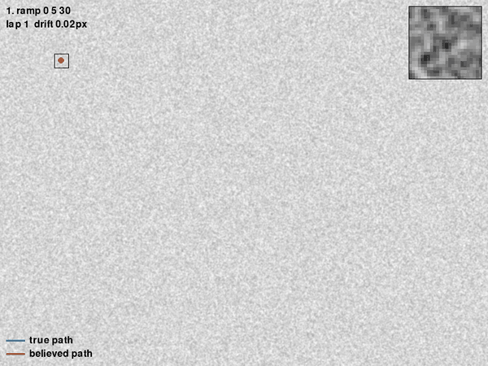
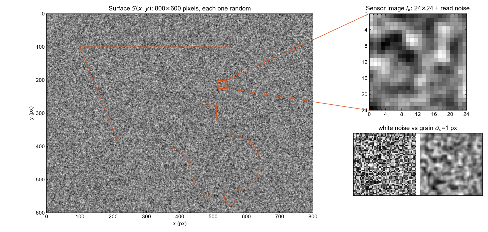
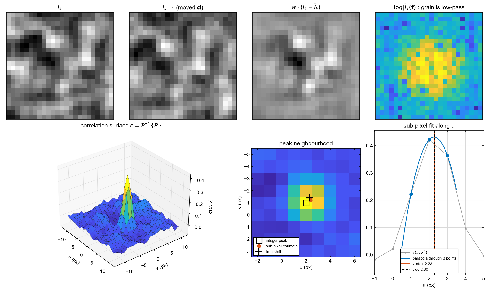
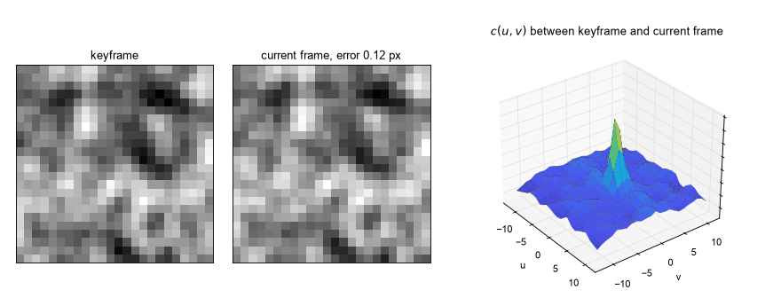
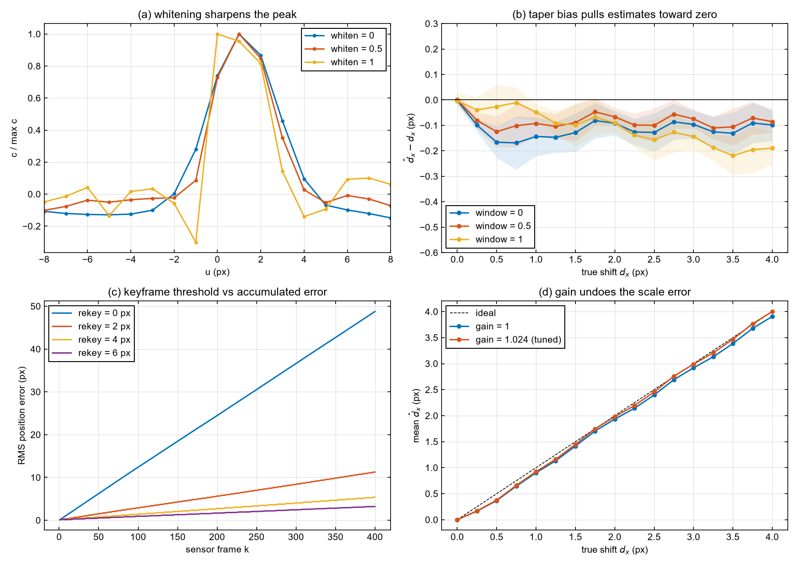
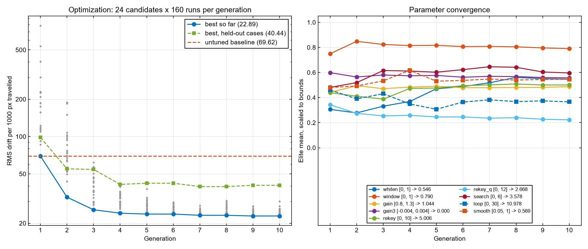
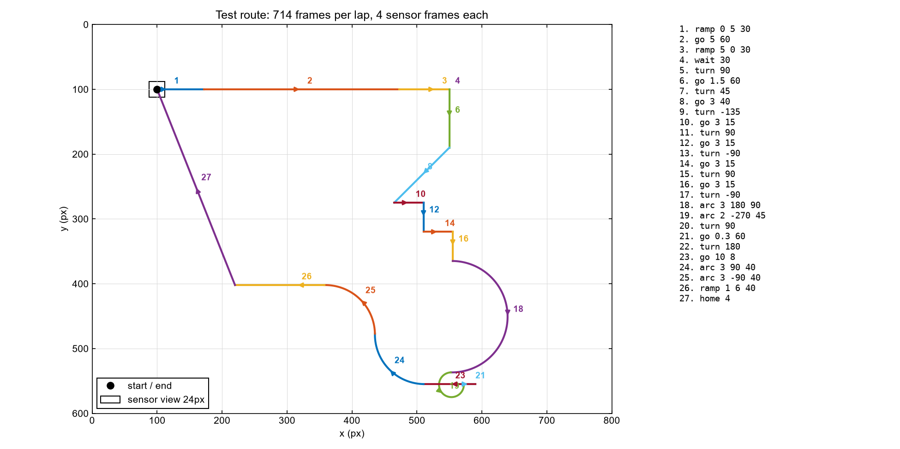
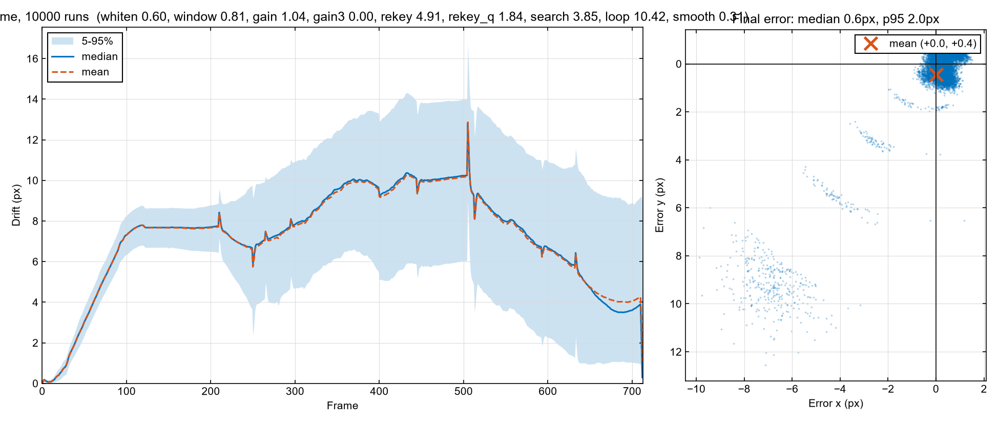
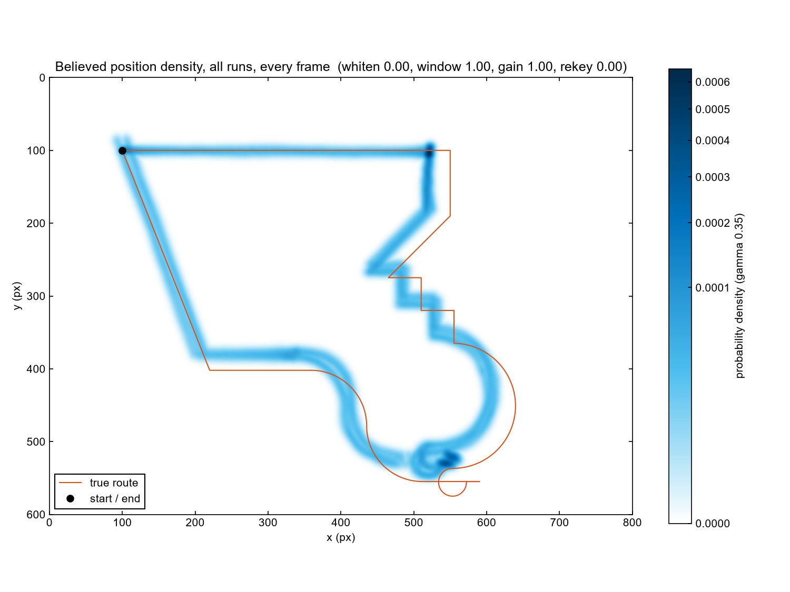
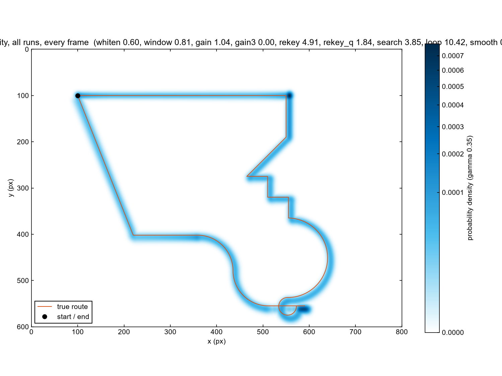

# MouseSim



An optical mouse has no idea where it is. It photographs a few hundred pixels of desk, compares that photo with the last one, guesses how far things slid, and adds the guess to a running total. Every guess is a little wrong, so the total wanders. I wanted to know how far, and how much of that a few tuned parameters can claw back.

```bash
pip install -r requirements.txt
python main.py              # live view
python main.py --route      # route diagram
python main.py --optimize   # tune the tracker (~25 min on 8 cores), writes best_params.json
python main.py --batch      # 10,000 runs: drift over time + density overlay
python figures.py           # regenerates every image in this README
```

## The desk



Every pixel starts as independent uniform noise, then gets a light Gaussian blur so the texture has grain the size of real paper fibres:

```math
N(x,y) \sim \mathcal{U}(0,1)\ \text{i.i.d.}, \qquad
\hat S(\mathbf f) = \hat N(\mathbf f)\, e^{-2\pi^2\sigma_s^2 \lVert \mathbf f\rVert^2}, \qquad
S \leftarrow \frac{S-\min S}{\max S-\min S}
```

The blur happens in the Fourier domain, so a Gaussian kernel costs one multiply per frequency.

## The sensor

The mouse sees a $`V \times V`$ window ($`V = 24`$) centred on its true position $`\mathbf p_k`$, sampled bilinearly because the mouse never sits on whole pixels, plus read noise:

```math
I_k(i,j) = \tilde S\!\left(\mathbf p_k + (j - \tfrac V2,\ i - \tfrac V2)\right) + \eta_{ij}, \qquad \eta_{ij} \sim \mathcal N(0, \sigma_n^2)
```

```math
\tilde S(x,y) = (1-f_x)(1-f_y)S_{00} + f_x(1-f_y)S_{01} + (1-f_x)f_y S_{10} + f_x f_y S_{11}
```

It samples four times per display frame. At 60 fps that is a 240 Hz sensor, which keeps the fastest flick under 2.5 px per sensor frame.

## Matching two frames



When the mouse moves by $`\mathbf d`$, the desk slides the other way under it: $`I_{k+1}(\mathbf x) = I_k(\mathbf x + \mathbf d)`$. The shift theorem turns that slide into a phase ramp, and the phase ramp is what the tracker hunts for.

Taper both frames, transform, and form the cross-power spectrum with partial whitening $`\beta`$:

```math
w_\alpha = (1-\alpha) + \alpha\, \mathbf h \mathbf h^{\mathsf T}, \qquad
\hat A = \mathcal F\{w_\alpha (I_k - \bar I_k)\}, \qquad
\hat B = \mathcal F\{w_\alpha (I_{k+1} - \bar I_{k+1})\}
```

```math
R(\mathbf f) = \frac{\hat A\, \hat B^{*}}{\lvert \hat A\, \hat B^{*}\rvert^{\beta}}
\;\approx\; \lvert \hat A\rvert^{2(1-\beta)}\, e^{-2\pi i\, \mathbf f \cdot \mathbf d},
\qquad c = \mathcal F^{-1}\{R\}
```

With $`\beta = 1`$ the magnitude cancels and $`c`$ collapses to a spike at $`\mathbf d`$ (phase correlation). With $`\beta = 0`$ it is plain cross-correlation, and the peak keeps the width of the texture's autocorrelation. Noise lives at high frequencies, so full whitening also amplifies it. The useful answer sits in between.

The integer peak comes from $`(u^*, v^*) = \arg\max c`$. A parabola through the peak and its two neighbours refines each axis:

```math
\delta_u = \frac{c_{-1} - c_{+1}}{2\,(c_{-1} - 2c_0 + c_{+1})}, \qquad
\hat{\mathbf d} = g\,(u^* + \delta_u,\ v^* + \delta_v)
```

$`g`$ is a gain. Without it the tracker under-reads every step, more on that below.

## Keyframes



Matching each frame against the previous one sums one error per sensor frame. Instead, the tracker holds a keyframe $`K`$ and measures every new frame against it, swapping only once the shift passes a threshold $`\tau`$:

```math
\hat{\mathbf p}_k = \hat{\mathbf p}_K + \hat{\mathbf d}(K \to k), \qquad
\lVert \hat{\mathbf d}(K \to k) \rVert \ge \tau \;\Rightarrow\; K \leftarrow k
```

Over a path of length $`L`$, per-frame tracking adds up $`N`$ errors. Keyframes add up roughly $`L/\tau`$. If each error carries a bias $`b`$ and noise $`\sigma`$:

```math
\lVert \mathbf e \rVert \approx n\,b + \sigma\sqrt{n}, \qquad
n_{\text{per-frame}} = N, \qquad n_{\text{keyframe}} \approx L/\tau
```



Panel (b) is the surprise. The taper weights the centre of each frame more than the edges, and the overlap between two shifted frames sits off-centre, so the peak gets pulled toward zero. That is a scale error, $`\mathbb E[\hat d] \approx (1-\kappa)\,d`$, and a gain $`g \approx 1/(1-\kappa)`$ cancels it (panel d). Panel (c) shows why $`\tau`$ matters most: 49 px of error after 400 frames without keyframes, 3 px with $`\tau = 6`$.

## Tuning

Four parameters, one number to minimise: RMS drift over a full lap, across $`M`$ runs and $`T`$ frames.

```math
\boldsymbol\theta = (\beta, \alpha, g, \tau), \qquad
J(\boldsymbol\theta) = \sqrt{\frac{1}{MT}\sum_{m=1}^{M}\sum_{t=1}^{T} \lVert \hat{\mathbf p}^{(m)}_t(\boldsymbol\theta) - \mathbf p_t \rVert^2}
```

The search is the cross-entropy method. Sample, keep the best quarter, refit:

```math
\boldsymbol\theta_i \sim \mathcal N(\boldsymbol\mu, \mathrm{diag}\boldsymbol\sigma^2), \qquad
\boldsymbol\mu \leftarrow \mathrm{mean}(E), \qquad
\boldsymbol\sigma \leftarrow \max\!\left(\mathrm{std}(E),\ 0.02\,(\boldsymbol\theta_{\max} - \boldsymbol\theta_{\min})\right)
```

Each generation scores 16 candidates on 160 runs each. Every candidate sees the same 32 textures and the same noise, so a difference in $`J`$ comes from the parameters and not from luck. Candidate one in generation one is the untuned tracker.



| parameter | meaning | bounds | tuned |
|---|---|---|---|
| $`\beta`$ `whiten` | spectrum flattening | 0 to 1 | 0.43 |
| $`\alpha`$ `window` | Hann taper strength | 0 to 1 | 0.46 |
| $`g`$ `gain` | scale correction | 0.8 to 1.3 | 1.024 |
| $`\tau`$ `rekey` | keyframe threshold, px | 0 to 8 | 7.0 |

## Results

The test route is 27 turtle commands (accelerate, brake, wait, zigzag, U-turn, tight loop, sub-noise creep, instant reversal, a 10 px flick, an S-curve) that end back where they started. One lap is 714 display frames.



| | untuned | tuned |
|---|---|---|
| RMS drift over a lap, optimizer textures | 31.05 px | **1.42 px** |
| final drift, median of 10,000 runs | 10.5 px | **2.1 px** |
| final drift, 95th percentile | 21.7 px | 4.0 px |
| mean final error $`(x, y)`$ | (+3.1, −7.9) px | (+1.0, −0.3) px |

The 10,000-run batch draws fresh textures the optimizer never saw, so the second row is out of sample.



The density map stacks every believed position from every run at every frame, smoothed with a Gaussian kernel ($`h = 3`$ px) on a histogram:

```math
\hat\rho(\mathbf x) = \frac{1}{MT}\sum_{m,t} K_h\!\left(\mathbf x - \hat{\mathbf p}^{(m)}_t\right)
```

| untuned | tuned |
|---|---|
|  |  |

Untuned, that cloud sat visibly inside the route, shrunk by the 8% scale error. Tuned, it hugs the line. The residual 2 px is mostly the $`(+1.0, -0.3)`$ px bias you can see in the scatter: the gain fixes the average scale, but not the direction-dependent part.

## Files

`main.py` holds the simulator, tracker, optimizer and charts. `figures.py` builds every image here from the same functions. `best_params.json` is the optimizer's output, and the live view and batch load it on start.
